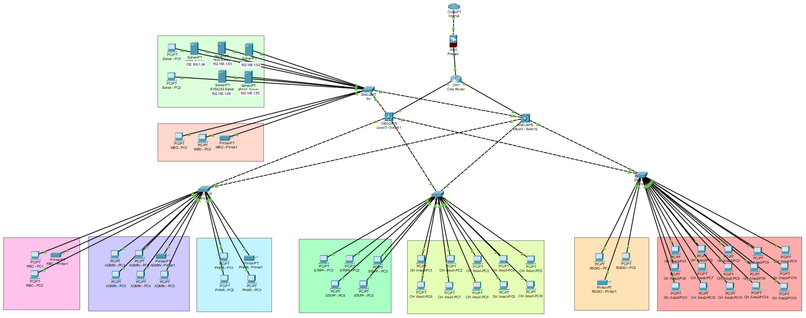
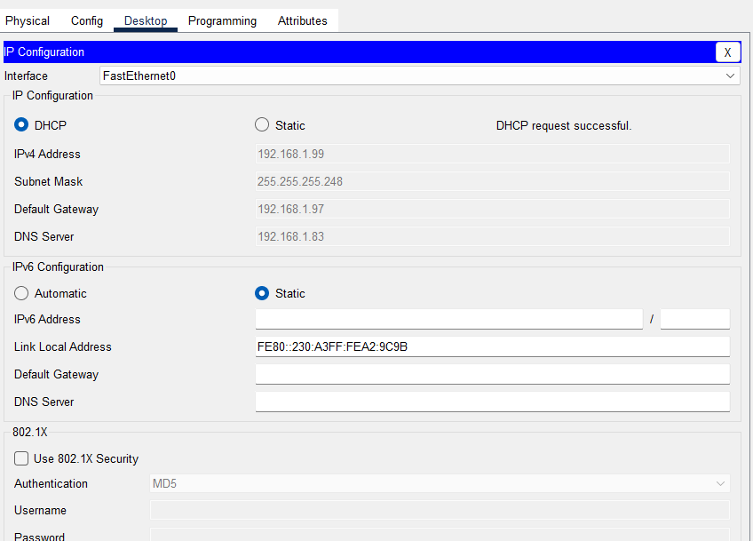
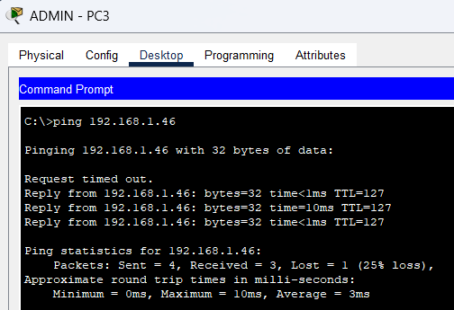
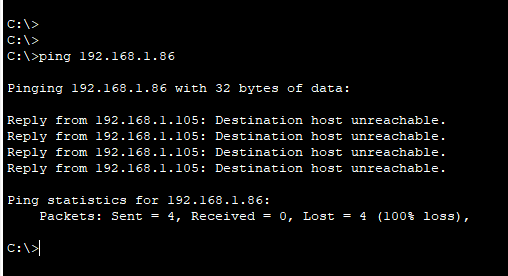
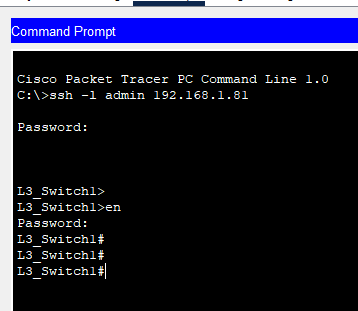
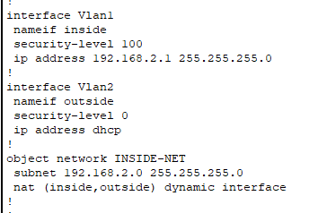

# 🛡️ Secure Enterprise Network Design: Health First Channelling

A secure network prototype for **Health First Channelling**, a healthcare organisation, designed and implemented in **Cisco Packet Tracer**. It protects sensitive patient data through segmentation, access control, perimeter security, and monitoring.




## 📌 Project Overview

Completed for **Unit 29: Network Security** (Pearson BTEC HND in Computing). The scenario required a secure network for a healthcare provider, where unprotected systems could expose patient records or interrupt services. The project covers security principles, network design, implementation, and testing against a formal test plan.

## 🏗️ Network Design

A **hierarchical design** (core, distribution, access) for scalability and easier troubleshooting:

- **Perimeter:** Cisco ASA firewall between the internet and the internal network
- **Core:** Cisco 2911 router
- **Distribution:** two Layer 3 switches for inter-VLAN routing
- **Access:** access switches connecting departmental PCs and printers
- **Servers:** DHCP, DNS, Web (HTTP), Email, and Syslog servers on a dedicated server VLAN

### VLAN segmentation

| VLAN | Department |
|---|---|
| 10 | Reception |
| 20 | Administration |
| 30 | Pharmacy |
| 40 | Staff Room |
| 50 | Channelling Area 1 |
| 60 | Radiology |
| 70 | Channelling Area 2 |
| 80 | Medicine Storage |
| 90 | Server Room |

Each VLAN has its own subnet, carved from the `192.168.1.0/24` range using variable-length subnet masks (VLSM).

## 🔐 Security Measures Implemented

| Control | Purpose |
|---|---|
| **VLAN segmentation** | Isolates departments and reduces broadcast traffic |
| **Inter-VLAN routing (SVIs)** | Controlled communication between VLANs on Layer 3 switches |
| **Access Control Lists** | Block unauthorised access between VLANs, for example Reception to the Server VLAN |
| **ASA firewall** | Inside/outside zones, security levels, dynamic NAT, and access rules at the perimeter |
| **SSH** | Encrypted remote management instead of Telnet |
| **Port security** | Limits each switch port to one device and shuts the port on violation |
| **DHCP** | Centralised, automatic addressing with a pool per VLAN |
| **Syslog** | Central logging for monitoring and troubleshooting |

### Sample configuration patterns

```
! VLAN
vlan 10
 name Reception

! Port security
switchport port-security
switchport port-security maximum 1
switchport port-security violation shutdown

! SSH (credentials omitted)
ip domain-name healthfirst.com
crypto key generate rsa
username admin secret <password>
```

## ✅ Test Plan and Results

| ID | Test | Expected result | Result |
|---|---|---|---|
| T1 | DHCP IP allocation | PCs receive IPs automatically | Pass |
| T2 | VLAN communication | Same-VLAN devices communicate | Pass |
| T3 | Inter-VLAN routing | Authorised VLANs communicate | Pass |
| T4 | ACL restriction | Reception cannot access the Server VLAN | Pass |
| T5 | SSH remote login | Secure login works | Pass |
| T6 | HTTP server access | Website opens | Pass |
| T7 | Email server | Emails send successfully | Pass |
| T8 | Syslog monitoring | Logs appear on the Syslog server | Pass |
| T9 | Port security | Unauthorised device is blocked | Pass |
| T10 | Firewall protection | Unauthorised external traffic is blocked | Pass |

### Evidence

**DHCP assigns addresses automatically**


**Inter-VLAN routing works**


**ACL blocks unauthorised access to the server network**


**SSH remote login to a Layer 3 switch**


**ASA firewall configuration (inside/outside zones and NAT)**


## 🚧 Limitations and Future Improvements

- **Single core router and single firewall**, so there is no failover if either fails
- **No IDS/IPS** to detect and prevent intrusions
- **No wireless network** or WPA3 security configured
- **No VPN** for secure remote access by doctors and administrators

Recommended next steps: redundant routers and firewalls, IDS/IPS, VPN access, wireless with WPA3, and SIEM-based monitoring.

## ▶️ How to Open the Project

1. Install **Cisco Packet Tracer** (free from Cisco Networking Academy).
2. Open [`health-first-secure-network.pkt`](health-first-secure-network.pkt).
3. Explore the topology and device configurations.

This is a simulation for learning. The lab credentials in it are not real.

## 📂 Repository Contents

| File | Description |
|---|---|
| `health-first-secure-network.pkt` | Packet Tracer project file |
| `images/` | Topology and test evidence |
| `report/` | Network security report |

## 👤 Author

**Afry Nizam**: BSc Information Technology student, University of West London
[LinkedIn](https://www.linkedin.com/in/afrynizam) · [GitHub](https://github.com/afrynizam07)
